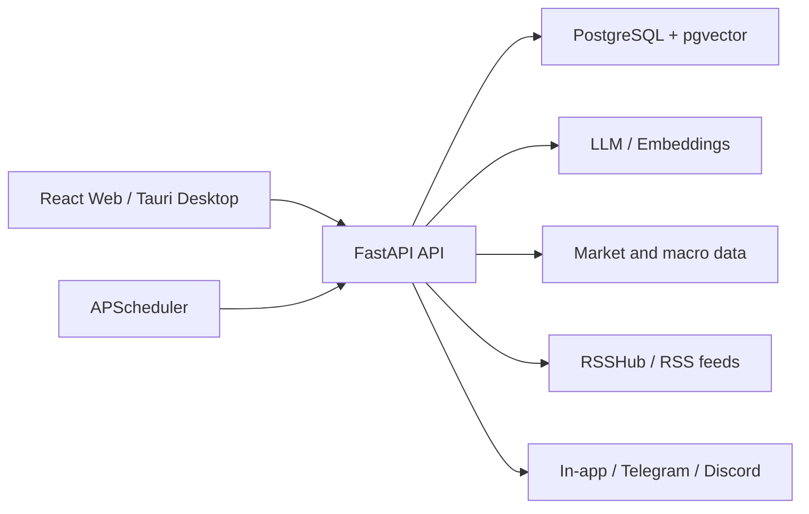

<div align="center">
  

  <h1>AntiTrade</h1>

  <p><strong>A self-hosted research, validation, journaling, and review workspace for independent traders.</strong></p>
  <p>Bring market context, AI-assisted research, trade review, strategy testing, portfolio tracking, and automation into one compact trading bench.</p>

  <p>
    <a href="./README.zh-CN.md">简体中文</a>
  </p>

  <p>
    <a href="#product-tour">Product Tour</a> ·
    <a href="#features">Features</a> ·
    <a href="#quick-start">Quick Start</a> ·
    <a href="#architecture">Architecture</a> ·
    <a href="#contributing">Contributing</a>
  </p>
</div>

---

## What is AntiTrade?

AntiTrade is a self-hosted trading research and review system organized around a trader's complete workflow:

> Observe the market → Form a plan → Validate the idea → Record the trade → Review and improve

It provides a web application and a Tauri desktop shell, with English and Simplified Chinese interfaces. AntiTrade does **not** connect to brokers or place orders, and it should not be treated as investment advice or a real-time signal service.

> [!IMPORTANT]
> AntiTrade is under active development. Features, APIs, and database schemas may change.

## Product Tour

[](./docs/hyperframes/antitrade-promo-video/renders/antitrade-promo.mp4)

**[Watch the full 27-second product tour](./docs/hyperframes/antitrade-promo-video/renders/antitrade-promo.mp4)**

## Features

| Area | Capabilities |
| --- | --- |
| Market overview | Cross-asset quotes, macro data, economic calendar, market regimes, and conditional scenarios |
| AI assistant | Research and review using read-only market tools and the trader's own context |
| Intelligence radar | Aggregated market news, official releases, RSS sources, bookmarks, summaries, and categories |
| Automations | Scheduled research, findings, reports, and in-app, Telegram, or Discord notifications |
| Trading journal | Trade records, bulk import, plans, rule checks, analytics, daily reviews, and replay |
| Strategies and backtests | Strategy library, historical backtests, optimization, out-of-sample tests, and walk-forward analysis |
| Portfolio | Multiple portfolios, multi-currency assets, allocation views, liabilities, import, and export |
| Trading tools | Position sizing, expectancy, drawdown, Monte Carlo, cost impact, and market clocks |
| Account | Email or Google sign-in, MFA, subscription billing, and bilingual UI |

## Quick Start

### Prerequisites

- Node.js 20+
- Python 3.11+
- Docker and Docker Compose
- Git

### 1. Clone the repository

```bash
git clone https://github.com/cccoven/antitrade.git
cd antitrade
```

### 2. Start PostgreSQL and RSSHub

```bash
docker compose -f backend/docker-compose.yml up -d
```

This starts PostgreSQL on `localhost:5433` and RSSHub on `http://localhost:1200`.

### 3. Configure and run the backend

```bash
cd backend
python3 -m venv .venv
./.venv/bin/pip install -r requirements.txt
cp .env.example .env
```

For an offline UI demo, set:

```dotenv
LLM_PROVIDER=demo
```

```bash
./.venv/bin/alembic upgrade head
./.venv/bin/python -m uvicorn main:app --host 0.0.0.0 --port 8000 --reload
```

The API is available at `http://localhost:8000`; OpenAPI docs are at `http://localhost:8000/docs`.

### 4. Run the frontend

In a second terminal:

```bash
cd frontend
npm install
npm run dev
```

Open `http://localhost:5173`. The development server proxies `/api` requests to the local FastAPI backend.

### Optional: run the desktop app

After installing Rust and the platform-specific Tauri prerequisites:

```bash
cd frontend
npm run desktop:dev
```

The desktop shell still requires a reachable FastAPI backend. Use `VITE_API_BASE_URL` to point production builds at a hosted API.

### Verify changes

```bash
(cd frontend && npm run build)
(cd backend && ./.venv/bin/python -m pytest)
```

Backend tests use Testcontainers and require Docker.

## Architecture



```text
antitrade/
├── frontend/          # Web app, Tauri shell, and frontend tests
├── backend/           # API, domain services, migrations, and backend tests
└── docs/              # HyperFrames compositions and product media
```

## Configuration

See [`backend/.env.example`](./backend/.env.example) and [`frontend/.env.example`](./frontend/.env.example) for the full set of options.

### Core settings

| Variable | Purpose | Required locally |
| --- | --- | --- |
| `DATABASE_URL` | PostgreSQL connection; defaults to local port `5433` | No |
| `LLM_PROVIDER` | `demo`, `openai`, or `anthropic` | Yes |
| `LLM_BASE_URL` | OpenAI-compatible API endpoint | Non-demo only |
| `LLM_API_KEY` | Model provider credential | Non-demo only |
| `LLM_MODEL` | Model name | Non-demo only |
| `JWT_SECRET` | Token signing secret; set a fixed value in production | Production only |
| `VITE_API_BASE_URL` | Frontend API root, including `/api` | Split deployments only |

### Data and integrations

| Variable | Capability |
| --- | --- |
| `TWELVE_DATA_API_KEY` | Equity, FX, crypto quotes, and candles |
| `FRED_API_KEY` | US macro time series |
| `FINNHUB_API_KEY` | Optional market-news enrichment |
| `TAVILY_API_KEY` | Live web search for the AI assistant |
| `EMBEDDINGS_*` | Strategy knowledge base and RAG |
| `GOOGLE_CLIENT_ID` | Google Identity Services sign-in |
| `MFA_ENCRYPTION_KEY` | MFA secret encryption |
| `TELEGRAM_*` | Telegram notifications and webhooks |
| `STRIPE_*` | Subscriptions, Checkout, and Billing Portal |

Missing optional services are hidden or gracefully degraded; they do not block the journal, portfolio, or local demo workflows.

## Data Sources

| Use case | Default source |
| --- | --- |
| Equity, FX, and crypto | Twelve Data |
| Futures candles | TradingView anonymous feed |
| US macro data | FRED |
| Economic calendar | Forex Factory weekly JSON |
| Market intelligence | Official RSS and RSSHub; Finnhub is optional |
| AI web search | Tavily, optional |

Third-party data may be delayed, rate-limited, or subject to licensing restrictions. Verify display and redistribution rights before a public or commercial deployment.

## Deployment

`backend/docker-compose.yml` is intended for local PostgreSQL and RSSHub development, not as a complete production stack. For production:

1. Deploy `frontend/dist` to static hosting or a CDN.
2. Run FastAPI as a separate service and limit analysis concurrency and memory.
3. Use PostgreSQL 16 with pgvector and persistent storage.
4. Terminate HTTPS at a reverse proxy and expose only required ports.
5. Set stable production secrets such as `JWT_SECRET` and `MFA_ENCRYPTION_KEY`.
6. Run only one built-in scheduler instance to prevent duplicate jobs.
7. Back up the database and uploaded assets regularly.

## Contributing

For substantial features or architectural changes, open an [Issue](https://github.com/cccoven/antitrade/issues) first and describe the problem, use case, and proposed direction.

Typical contribution flow:

1. Fork the repository and create a focused branch.
2. Keep the change small and add relevant tests.
3. Run the verification commands above.
4. Open a pull request with behavior changes, test results, and UI screenshots when applicable.

## Security and Disclaimer

- Never commit `.env` files, API keys, webhook secrets, or user data.
- AI output and third-party market data are for research and review only.
- AntiTrade does not execute orders; users must independently verify data, strategies, and risk.

## License

AntiTrade is licensed under the [GNU Affero General Public License v3.0](./LICENSE).
