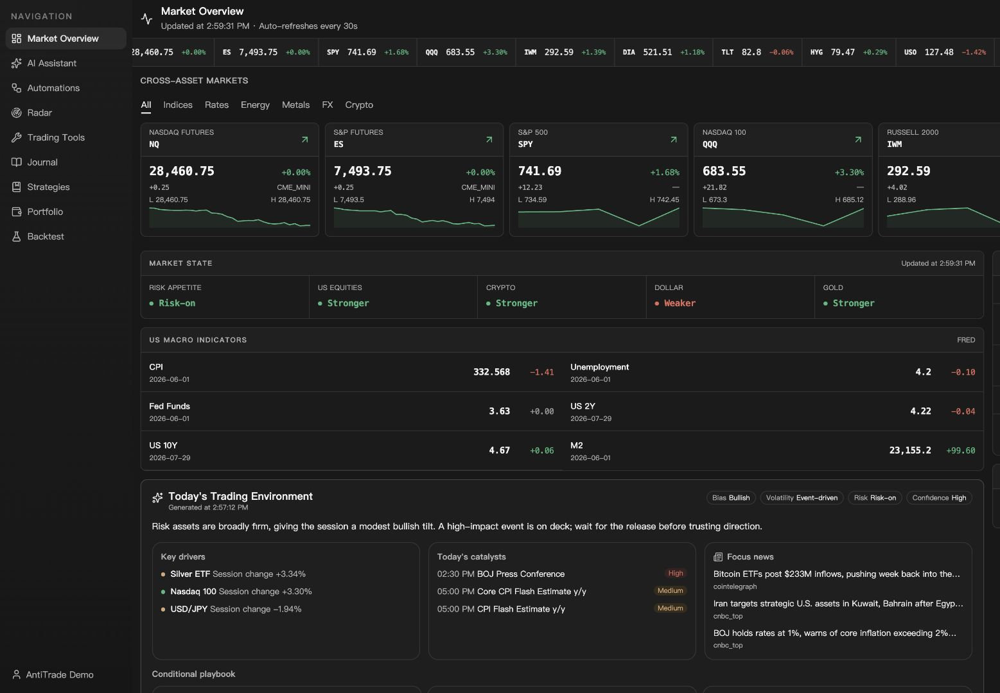
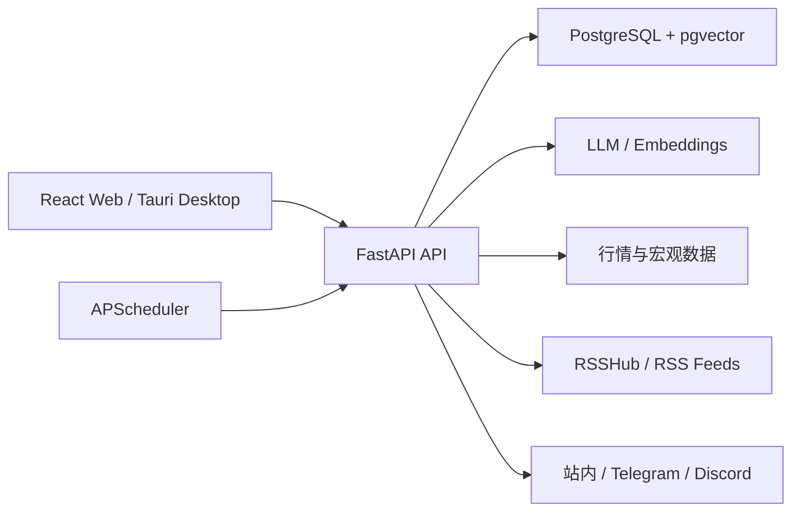

<div align="center">
  

  <h1>AntiTrade</h1>

  <p><strong>面向独立交易者的自托管研究、验证、记录与复盘工作台。</strong></p>
  <p>把市场背景、AI 辅助研究、交易复盘、策略测试、资产跟踪和自动化放进一个紧凑的 trading bench。</p>

  <p>
    <a href="./README.md">English</a>
  </p>

  <p>
    <a href="#产品视频">产品视频</a> ·
    <a href="#功能概览">功能</a> ·
    <a href="#快速开始">快速开始</a> ·
    <a href="#系统架构">架构</a> ·
    <a href="#参与贡献">贡献</a>
  </p>
</div>

---

## AntiTrade 是什么？

AntiTrade 是一套可自托管的交易研究与复盘系统，围绕交易者的完整工作流组织信息：

> 观察市场 → 形成计划 → 验证想法 → 记录交易 → 复盘改进

它提供 Web 应用和 Tauri 桌面壳，支持英文与简体中文。AntiTrade **不连接券商、不自动下单**，也不应被视为投资建议或实时交易信号服务。

> [!IMPORTANT]
> AntiTrade 目前处于积极开发阶段，功能、接口和数据库结构仍可能变化。

## 产品视频

[](./docs/hyperframes/antitrade-promo-video/renders/antitrade-promo.mp4)

**[观看 27 秒完整产品导览](./docs/hyperframes/antitrade-promo-video/renders/antitrade-promo.mp4)**

## 功能概览

| 模块 | 能力 |
| --- | --- |
| 市场概览 | 跨资产报价、宏观数据、经济日历、市场环境与条件式剧本 |
| AI 助手 | 基于只读市场工具和个人交易上下文进行研究与复盘 |
| 情报雷达 | 聚合市场资讯、官方数据发布与 RSS 来源，支持收藏、摘要和分类 |
| 自动化 | 定时运行研究任务，沉淀发现与报告，并通过站内、Telegram 或 Discord 通知 |
| 交易日志 | 交易记录、批量导入、交易计划、规则检查、统计分析、每日复盘与回放 |
| 策略与回测 | 策略库、历史回测、参数优化、样本外验证和 Walk-forward 分析 |
| 资产组合 | 多组合、多币种资产记录，支持配置分析、负债、导入与导出 |
| 交易工具 | 仓位计算、期望值、回撤、Monte Carlo、成本影响和市场时钟 |
| 账户能力 | 邮箱或 Google 登录、MFA、订阅计费和中英文界面 |

## 快速开始

### 前置要求

- Node.js 20+
- Python 3.11+
- Docker 与 Docker Compose
- Git

### 1. 获取代码

```bash
git clone https://github.com/cccoven/antitrade.git
cd antitrade
```

### 2. 启动 PostgreSQL 和 RSSHub

```bash
docker compose -f backend/docker-compose.yml up -d
```

默认启动 PostgreSQL `localhost:5433` 和 RSSHub `http://localhost:1200`。

### 3. 配置并启动后端

```bash
cd backend
python3 -m venv .venv
./.venv/bin/pip install -r requirements.txt
cp .env.example .env
```

如果只想体验界面和离线 AI 流程，设置：

```dotenv
LLM_PROVIDER=demo
```

```bash
./.venv/bin/alembic upgrade head
./.venv/bin/python -m uvicorn main:app --host 0.0.0.0 --port 8000 --reload
```

API 地址为 `http://localhost:8000`，OpenAPI 文档位于 `http://localhost:8000/docs`。

### 4. 启动前端

打开另一个终端：

```bash
cd frontend
npm install
npm run dev
```

访问 `http://localhost:5173`。开发服务器会把 `/api` 请求代理到本地 FastAPI。

### 可选：启动桌面端

安装 Rust 和对应平台的 Tauri 系统依赖后：

```bash
cd frontend
npm run desktop:dev
```

桌面壳仍需要可访问的 FastAPI 后端。生产构建可通过 `VITE_API_BASE_URL` 指向线上 API。

### 验证改动

```bash
(cd frontend && npm run build)
(cd backend && ./.venv/bin/python -m pytest)
```

后端测试使用 Testcontainers，需要 Docker。

## 系统架构



```text
antitrade/
├── frontend/          # Web 应用、Tauri 桌面壳和前端测试
├── backend/           # API、领域服务、迁移与后端测试
└── docs/              # HyperFrames 工程与产品媒体素材
```

## 配置

完整配置见 [`backend/.env.example`](./backend/.env.example) 和 [`frontend/.env.example`](./frontend/.env.example)。

### 核心配置

| 变量 | 用途 | 本地是否必需 |
| --- | --- | --- |
| `DATABASE_URL` | PostgreSQL 连接；默认使用本地 `5433` | 否 |
| `LLM_PROVIDER` | `demo`、`openai` 或 `anthropic` | 是 |
| `LLM_BASE_URL` | OpenAI-compatible API 地址 | 非 demo 必需 |
| `LLM_API_KEY` | 模型服务密钥 | 非 demo 必需 |
| `LLM_MODEL` | 模型名称 | 非 demo 必需 |
| `JWT_SECRET` | 登录令牌签名密钥；生产环境必须固定设置 | 生产必需 |
| `VITE_API_BASE_URL` | 前端 API 根地址，包含 `/api` | 仅分离部署 |

### 数据源与集成

| 变量 | 对应能力 |
| --- | --- |
| `TWELVE_DATA_API_KEY` | 股票、外汇、加密货币报价和 K 线 |
| `FRED_API_KEY` | 美国宏观时间序列 |
| `FINNHUB_API_KEY` | 可选的市场新闻增强 |
| `TAVILY_API_KEY` | AI 助手实时 Web Search |
| `EMBEDDINGS_*` | 策略知识库与 RAG |
| `GOOGLE_CLIENT_ID` | Google Identity Services 登录 |
| `MFA_ENCRYPTION_KEY` | MFA 密钥加密 |
| `TELEGRAM_*` | Telegram 通知与 Webhook |
| `STRIPE_*` | 订阅、Checkout 与 Billing Portal |

未配置可选服务时，对应能力会隐藏或降级，不会阻止日志、组合和本地演示功能运行。

## 数据来源

| 场景 | 默认来源 |
| --- | --- |
| 股票、外汇、加密货币 | Twelve Data |
| 期货 K 线 | TradingView anonymous feed |
| 美国宏观数据 | FRED |
| 经济日历 | Forex Factory 每周 JSON |
| 市场资讯 | 官方 RSS、RSSHub，Finnhub 可选 |
| AI Web Search | Tavily，可选 |

第三方数据可能延迟、限流或受授权范围约束。公开或商业部署前，请确认行情、新闻和模型服务的展示与再分发许可。

## 部署说明

`backend/docker-compose.yml` 仅用于本地 PostgreSQL 和 RSSHub 开发环境，不是完整生产编排。生产环境建议：

1. 将 `frontend/dist` 部署到静态托管或 CDN。
2. 独立运行 FastAPI，并限制后台分析的并发和内存。
3. 使用 PostgreSQL 16 + pgvector 和持久化存储。
4. 在反向代理层终止 HTTPS，只开放必要端口。
5. 固定设置 `JWT_SECRET`、`MFA_ENCRYPTION_KEY` 等生产密钥。
6. 只运行一个内置调度器实例，避免任务重复执行。
7. 定期备份数据库和上传文件。

## 参与贡献

提交较大的功能或架构改动前，建议先创建 [Issue](https://github.com/cccoven/antitrade/issues)，说明问题、使用场景和预期方向。

典型贡献流程：

1. Fork 仓库并创建聚焦的功能分支。
2. 保持改动小而明确，并补充必要测试。
3. 运行上方验证命令。
4. 提交 Pull Request，说明行为变化、验证结果和相关界面截图。

## 安全与免责声明

- 不要提交 `.env`、API Key、Webhook Secret 或用户数据。
- AI 输出和第三方行情仅用于研究与复盘。
- AntiTrade 不负责订单执行，使用者应独立验证数据、策略和风险。

## 许可证

AntiTrade 使用 [GNU Affero General Public License v3.0](./LICENSE) 开源。
